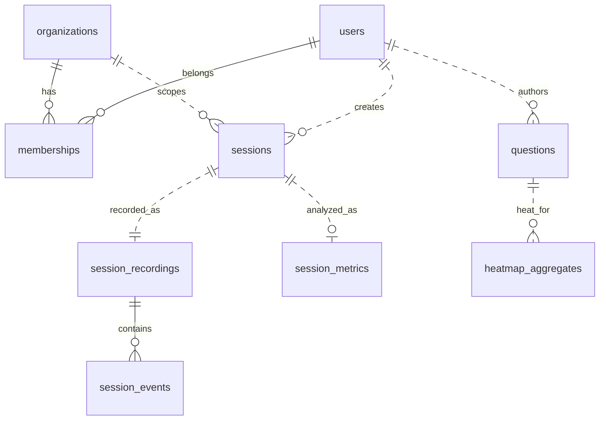
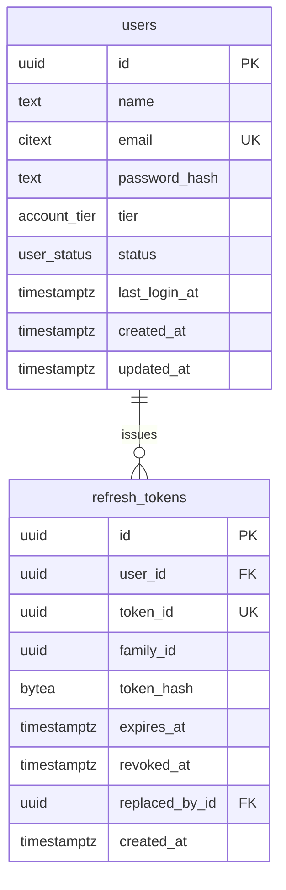
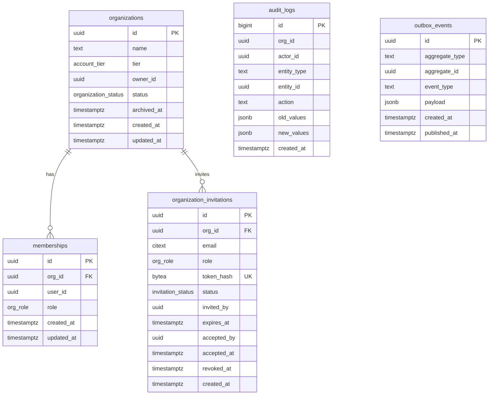
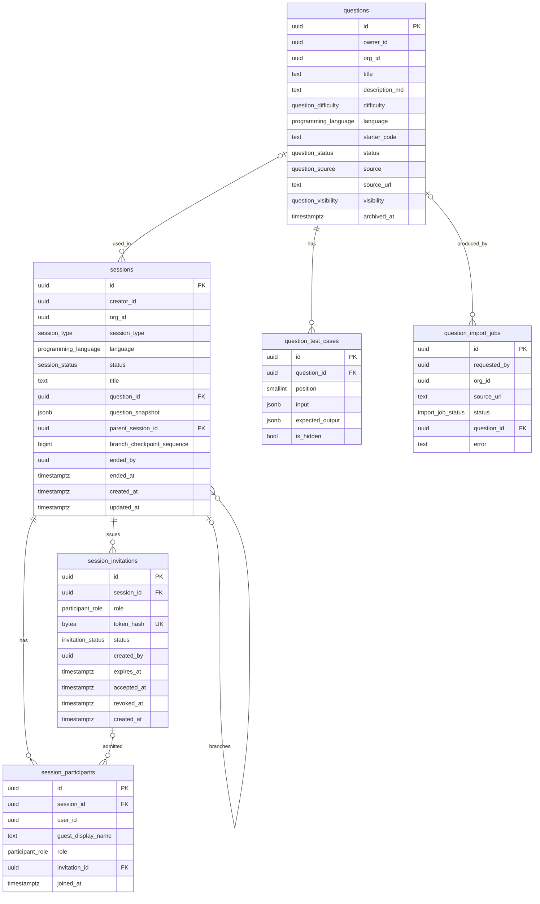
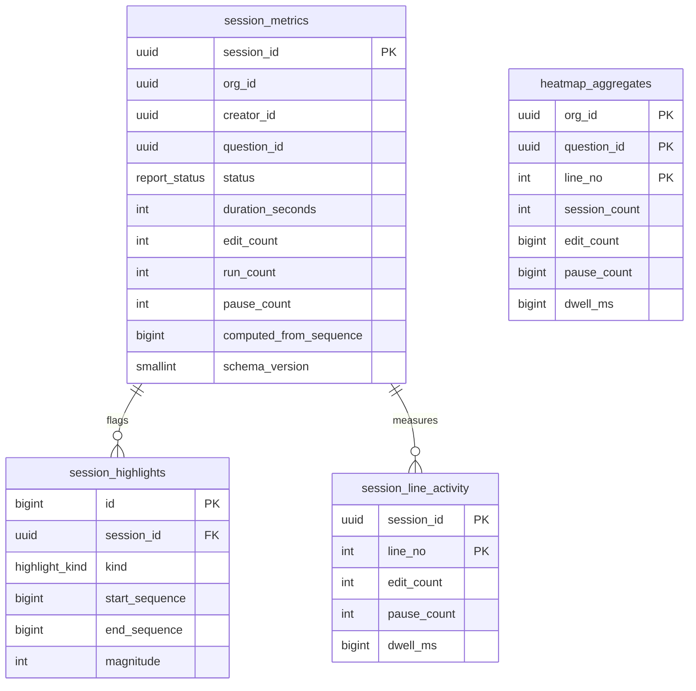
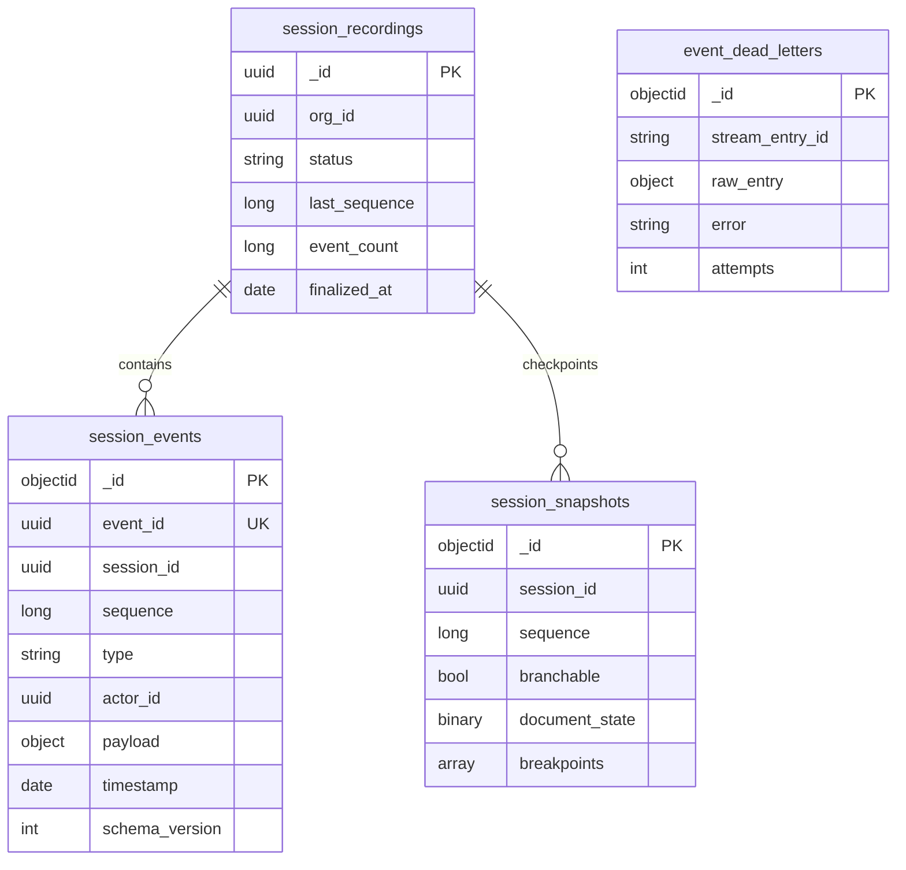

# PairScope: Database Design Document

Oct 28, 2026 · @Nishad

|  |  |
| --- | --- |
| **Project** | PairScope, collaborative technical interview and debugging platform |
| **Datastores** | PostgreSQL 16+ (Identity, Organization, Session, Insights), MongoDB (Recorder), Redis 7+ (Realtime, Execution, queues, event stream) |
| **Required extension** | `citext` (PostgreSQL) |
| **Schema source** | DBML file `PairScope_schema.dbml` (import into dbdiagram.io to render the ERD) |
| **Related** | PairScope MVP Product Requirements Document, v0.2 |
| **Document status** | Draft for review |
| **Last updated** | 28 Oct 2026 |

> **How to read this document.** **\[Plan\]** marks anything taken from the PRD or the project planning document. **\[Proposed\]** marks a design decision made in this document: a column, constraint, index or technology choice. **Where this document departs from the plan:** Identity, Organization and Session use PostgreSQL instead of MongoDB (Section 2.3). Services that emit events get an outbox table. Several supporting tables (participants, invitations, test cases, import jobs, report highlights) are made explicit.

---

## 1. System Overview

PairScope stores three very different kinds of data: durable business records (accounts, organizations, sessions, questions), a high-volume ordered history of what happened inside each session, and short-lived live state (presence, debugger control, job queues). No single engine suits all three, so each service gets the store that matches its data. Every service owns its data exclusively. Services refer to each other by ID and never read another service's database. \[Plan\]

### 1.1 Services and Stores

| Service | Engine | Logical database | Owns |
| --- | --- | --- | --- |
| Identity | PostgreSQL | `identity_db` | `users`, `refresh_tokens` |
| Organization | PostgreSQL | `organization_db` | `organizations`, `memberships`, `organization_invitations`, `audit_logs`, `outbox_events` |
| Session | PostgreSQL | `session_db` | `sessions`, `session_participants`, `session_invitations`, `questions`, `question_test_cases`, `question_import_jobs`, `audit_logs`, `outbox_events` |
| Realtime | Redis | prefix `rt:` | live document state, presence, debugger ownership |
| Execution | Redis | prefix `exec:` | run state, debug state, execution queue, concurrency limits |
| Recorder | MongoDB | `recorder` | `session_recordings`, `session_events`, `session_snapshots`, `event_dead_letters` |
| Insights | PostgreSQL | `insights_db` | `session_metrics`, `session_highlights`, `session_line_activity`, `heatmap_aggregates`, `inbox_events` |
| Gateway | Redis | prefix `gw:` | rate-limit counters only; no business data |

Total: **20 PostgreSQL tables** in four databases, **4 MongoDB collections**, **10 Redis key families**, **18 enum types** (`account_tier` and `invitation_status` are each defined separately in every database that uses them) and one PostgreSQL extension (`citext`).

### 1.2 Data Lifecycle

1. A user signs up (Identity) and creates an organization (Organization), becoming its owner.
2. A session is created (Session) with an optional question. Participants join through invitations.
3. While the session is live, document state, presence and debugger ownership sit in Redis. Every accepted edit and debug action is published to a durable stream and persisted by the Recorder in MongoDB.
4. When the session ends, the Session service writes a `session.ended` outbox row. The Recorder finalizes the recording. Insights then builds the report, highlights and heatmap rows in PostgreSQL.
5. Replay reads ordered events and snapshots from MongoDB. A branch creates a new Session row that points to its parent and a checkpoint sequence.

---

## 2. Database Technology Decisions

### 2.1 Decision Criteria

Each data set was judged on five questions:

1. **Shape:** is the structure stable and relational, or varied and nested?
2. **Integrity:** must the database itself guarantee uniqueness, ownership and referential rules?
3. **Consistency:** does a business action need to change several records atomically?
4. **Access pattern:** point lookups, joins and filters, ordered range scans, or sub-millisecond shared state?
5. **Lifetime:** durable system of record, derived data, or ephemeral state?

### 2.2 Workload Classification

| Data | Shape | Integrity and consistency | Dominant access | Lifetime | Store |
| --- | --- | --- | --- | --- | --- |
| Users, refresh tokens | Fixed columns | Unique email, token rotation, revocation | Point lookup by email or token ID | Durable | PostgreSQL |
| Organizations, memberships, invitations | Fixed, many-to-many | One owner per organization, unique membership, organization and owner membership created atomically | Lookup by user, list by organization | Durable | PostgreSQL |
| Sessions, participants, invitations | Fixed, relational | Participants unique per session, branch parent must exist, one-way status change | Lists filtered by user and organization | Durable | PostgreSQL |
| Questions and test cases | Fixed plus small JSON inputs | Ordered child rows, validated shapes | List and filter, load one by ID | Durable | PostgreSQL (`jsonb` for test inputs) |
| Report metrics, highlights, heatmaps | Numeric facts | Recomputable, grouped across sessions | SQL aggregation and filters | Derived | PostgreSQL |
| Session event history | One envelope, different payload per event type, binary Yjs updates | Per-session order, duplicate-safe ingest; no joins, no multi-record transactions | High-rate append, range scan by session and sequence | Durable, append-only | MongoDB |
| Snapshots | Large documents with binary state | Immutable once written | Fetch latest at or before a sequence | Durable | MongoDB |
| Live document, presence, debugger ownership | Small keyed values | Last write wins, with a fencing version for ownership | Sub-millisecond reads and writes, TTL expiry | Ephemeral | Redis |
| Job queues, durable event stream, rate-limit counters | Queue and stream structures | At-least-once with acknowledgement | Producer and consumer | Short-lived | Redis (BullMQ, Streams) |

### 2.3 Why Relational (PostgreSQL) for Identity, Organization and Session

**\[Proposed\] This departs from the planning document, which listed MongoDB for these three services.**

1. **The data is relational and its rules are the product.** Memberships link users to organizations, participants link users to sessions, test cases belong to questions. PostgreSQL enforces these with foreign keys, `UNIQUE` and partial unique indexes, and `CHECK` constraints. “Exactly one owner per organization” is a single partial unique index in PostgreSQL. In MongoDB it becomes application code plus a hand-built unique index.
2. **The plan already requires atomic multi-record writes.** Creating an organization and its owner membership inside one transaction boundary is a transaction across two tables. PostgreSQL gives this by default. MongoDB multi-document transactions need a replica set, which adds operational weight to a small home lab.
3. **List views are joins and filters.** Sessions I created or joined, sessions in my organization and members of an organization are indexed joins, which relational engines are built for.
4. **Tenant isolation can be enforced twice.** Row Level Security gives a second boundary below endpoint authorization (Section 12.2).
5. **Nothing here needs a flexible schema.** These entities have stable shapes. `jsonb` is used only where content really varies: test-case inputs, the question snapshot, audit values and outbox payloads.

If you prefer to keep MongoDB for these three services, the entities and fields in Section 6 still apply. The constraints then move into application code and unique indexes, and MongoDB must run as a replica set for the atomic organization-plus-owner write.

### 2.4 Why a Document Store (MongoDB) for the Event History

1. **Polymorphic payloads.** Every event shares one envelope (`eventId`, `sessionId`, `sequence`, `type`, `actorId`, `timestamp`, `payload`, `schemaVersion`), but the payload differs by type: a Yjs update, a breakpoint, a paused call stack. A document model stores this without a column per field or a payload table per type. \[Plan\]
2. **Append-heavy, never joined, never updated.** Events are written once and read back by `(sessionId, sequence)`. There is nothing to join and no multi-record transaction. This keeps the highest-volume writes off the transactional PostgreSQL servers and protects failure isolation.
3. **Native binary and nested values.** Yjs updates and breakpoint lists fit documents directly.
4. **A natural shard key.** `sessionId` partitions cleanly if volume ever demands sharding.
5. **Fits the existing skill set.** The MERN foundation makes MongoDB the cheapest engine to operate well.

**Trade-off and fallback.** This adds a second database engine to run. If operating both proves too heavy on the 4 GB home lab, `session_events` and `session_snapshots` can move into range-partitioned PostgreSQL tables with a `jsonb` payload, keeping the same envelope and the same two indexes (Appendix A). Nothing above the Recorder changes.

### 2.5 Why Redis for Live State and the Event Pipeline

Presence, cursors, debugger ownership and per-run execution state change many times a second, are meaningless after the session, and need sub-millisecond access from several Realtime instances. Redis provides this with TTLs, hashes and pub/sub. BullMQ provides the execution and analytics queues, and Redis Streams provide the durable event pipeline with consumer groups and acknowledgement. \[Plan\] **Redis is never a system of record.** Anything that must survive is written to PostgreSQL or MongoDB, and Pub/Sub is not the event store. \[Plan\]

### 2.6 Considered and Deferred

| Option | Decision |
| --- | --- |
| One engine for everything | Rejected. A single transactional database would carry the event-write load, and sub-millisecond live state does not belong in it. |
| Kafka or a dedicated broker | Deferred. Redis Streams with consumer groups cover the MVP. Revisit if throughput or retention outgrows Redis. |
| TimescaleDB, ClickHouse | Deferred. Insights data is small, derived and recomputable. The TimescaleDB extension can be enabled in `insights_db` later if time-series queries justify it. \[Plan\] |
| Elasticsearch or full-text search | Deferred. Question lists are small. Add `pg_trgm` on `questions.title` when search is required. |
| A database per entity | Rejected. Ownership is per service, not per table. |

### 2.7 Physical Topology

Logical ownership is strict. Physical deployment is economical:

- **One PostgreSQL server, four databases** (`identity_db`, `organization_db`, `session_db`, `insights_db`), each with its own login role. Separate databases make cross-service joins impossible by construction, which enforces the no-cross-database-read rule. A small home lab can host all four on one server. Move a database to its own server only when load demands it.
- **One MongoDB instance** with a single `recorder` database.
- **One Redis instance** with ACL users per key prefix (`rt:`, `exec:`, `evt:`, `insights:`, `gw:`). Beyond the demo, run the `evt:` stream keys on a separate Redis instance with stricter persistence (Section 6.6).

---

## 3. Design Principles and Conventions

| Topic | Convention |
| --- | --- |
| Primary keys | `uuid`, generated by the application as time-ordered UUIDv7. IDs cross service boundaries and appear in events, so they must not be guessable counters. Exceptions: append-only logs (`audit_logs`, `session_highlights`) use `bigint` identity. The API may prefix IDs for display (`usr_`, `ses_`); the database stores the bare UUID. |
| Cross-service references | A plain `uuid` column with no foreign key, documented as a logical reference. Consistency is kept by JWT claims, validation at write time and events. |
| Timestamps | `timestamptz`, stored in UTC. All tables carry `created_at`; mutable tables also carry `updated_at`. |
| Case-insensitive text | `citext` for email. |
| Text | `text` with `CHECK` length limits instead of `varchar(n)`. |
| Enumerations | Native PostgreSQL enum types for closed, stable sets that one service owns (Section 5). Values are added by migration only. Open-ended sets (audit actions, event types) are `text` with a documented catalogue. |
| JSON | `jsonb` only where the content is genuinely variable. Core fields are real columns. |
| Secrets | Passwords are bcrypt hashes. Refresh tokens and invitation tokens are stored as SHA-256 digests in `bytea`. High-entropy random tokens do not need a slow hash. Plaintext is never stored. |
| Naming | `snake_case`, plural table names, `_id` suffix for references, `_at` for timestamps, `_by` for actor IDs. |
| Soft delete | Not used for business records. State is expressed by status columns and `archived_at`. Expired or revoked credentials are physically purged by retention jobs. |
| Events and reliability | Services that publish events write an `outbox_events` row in the same transaction as the business change. Consumers record processed event IDs for idempotency. |
| Constraint placement | Declarative constraints in the database first, service-layer rules second. A rule that can be a `CHECK`, `UNIQUE` or foreign key is one. |
| Indexing | Only for a named query or constraint. Every index in Section 11 states the query it serves. |

---

## 4. Entity Relationship Diagrams

Notation: crow's foot. `PK` primary key, `FK` foreign key, `UK` unique. Dotted lines are **logical references across services**, which are not enforced by foreign keys. The full interactive ERD is generated from `PairScope_schema.dbml` in dbdiagram.io. The diagrams below use Mermaid, which renders in most Markdown viewers.

### 4.1 Cross-Service Logical Model

Identity owns `users`. Organization owns `organizations` and `memberships`. Session owns `sessions` and `questions`. Recorder owns `session_recordings` and `session_events`. Insights owns `session_metrics` and `heatmap_aggregates`. Dotted lines cross a service boundary. The `users`-`memberships` line is also logical, since the two live in different databases.

### 4.2 Identity (`identity_db`)

### 4.3 Organization (`organization_db`)

`audit_logs` and `outbox_events` are standalone tables with no foreign keys, by design: they must outlive the rows they describe.

### 4.4 Session (`session_db`)

`audit_logs` and `outbox_events` follow the same standalone pattern as in Section 4.3.

### 4.5 Insights (`insights_db`)

`heatmap_aggregates` is derived from `session_line_activity` and has no foreign key. It is rebuilt per `(org_id, question_id)` whenever a report is recomputed. `inbox_events` is a standalone idempotency table.

### 4.6 Recorder (`recorder`, MongoDB)

MongoDB has no foreign keys. The relationships above are enforced by the ingest logic and by the unique indexes in Section 6.5.

---

## 5. Enumerations

All **\[Proposed\]** unless marked **\[Plan\]**. Enums are defined per database. Values can be added with `ALTER TYPE ... ADD VALUE` but never removed, so each set holds only values the MVP needs, plus one reserved value where the plan names it.

| Database | Enum | Values | Used by |
| --- | --- | --- | --- |
| identity\_db | `account_tier` | `free`, `pro` (reserved, unused in MVP) | `users.tier` |
| identity\_db | `user_status` | `active`, `disabled` | `users.status` |
| organization\_db | `account_tier` | `free`, `pro` (reserved, unused in MVP) | `organizations.tier` |
| organization\_db | `organization_status` | `active`, `archived` | `organizations.status` |
| organization\_db | `org_role` \[Plan\] | `owner`, `interviewer` | `memberships.role`, `organization_invitations.role` |
| organization\_db | `invitation_status` | `pending`, `accepted`, `revoked`, `expired` | `organization_invitations.status` |
| session\_db | `session_type` \[Plan\] | `interview`, `pair_debugging` | `sessions.session_type` |
| session\_db | `session_status` \[Plan\] | `active`, `ended` | `sessions.status` |
| session\_db | `programming_language` | `javascript` | `sessions.language`, `questions.language` |
| session\_db | `participant_role` | `interviewer`, `candidate`, `participant` | `session_participants.role`, `session_invitations.role` |
| session\_db | `invitation_status` | `pending`, `accepted`, `revoked`, `expired` | `session_invitations.status` |
| session\_db | `question_difficulty` | `easy`, `medium`, `hard` | `questions.difficulty` |
| session\_db | `question_status` | `draft`, `active`, `archived` | `questions.status` |
| session\_db | `question_source` | `manual`, `leetcode` | `questions.source` |
| session\_db | `question_visibility` | `private`, `organization` | `questions.visibility` |
| session\_db | `import_job_status` | `queued`, `running`, `succeeded`, `failed` | `question_import_jobs.status` |
| insights\_db | `report_status` | `pending`, `processing`, `ready`, `failed` | `session_metrics.status` |
| insights\_db | `highlight_kind` \[Plan\] | `long_pause`, `repeated_edits` | `session_highlights.kind` |

`pair_debugging` covers the remote-development-pair user in the PRD. Event types and audit actions are not enums because they are open-ended; their catalogues are in Sections 6.5 and 6.2.4.

---

## 6. Table Reference

Legend: **PK** primary key, **FK** foreign key, **UQ** unique, **NN** not null, **D** default. A **logical** reference points at another service's data and has no foreign key.

### 6.1 Identity (`identity_db`)

#### 6.1.1 `users`

One account table for everyone who signs in. Organization roles live in the Organization service, not here. \[Plan\]

| Column | Type | Constraints | Notes |
| --- | --- | --- | --- |
| `id` | uuid | PK | UUIDv7, application generated. |
| `name` | text | NN, CHECK length 1 to 100 |  |
| `email` | citext | NN, UQ | Trimmed before insert. Login identifier. |
| `password_hash` | text | NN | bcrypt, cost 12 or higher. Never logged or returned. |
| `tier` | account\_tier | NN, D `free` | \[Plan\] |
| `status` | user\_status | NN, D `active` | `disabled` blocks login and refresh. |
| `last_login_at` | timestamptz |  |  |
| `created_at`, `updated_at` | timestamptz | NN, D `now()` |  |

**Indexes:** none beyond the PK and the unique index on `email`, which serves the login lookup.

**Rules:** email is unique case-insensitively through `citext`. In the MVP users are disabled, not deleted. A deletion request removes the row and cascades to `refresh_tokens`.

#### 6.1.2 `refresh_tokens`

One row per issued refresh token. Rotation inserts a new row and revokes the old one. \[Plan\]

| Column | Type | Constraints | Notes |
| --- | --- | --- | --- |
| `id` | uuid | PK |  |
| `user_id` | uuid | NN, FK to `users`, ON DELETE CASCADE |  |
| `token_id` | uuid | NN, UQ | Public lookup ID carried in the cookie beside the secret. \[Plan\] |
| `family_id` | uuid | NN | One login chain. Reuse of a revoked token revokes the whole family. |
| `token_hash` | bytea | NN, CHECK `octet_length = 32` | SHA-256 digest of the secret. |
| `expires_at` | timestamptz | NN, CHECK `expires_at > created_at` | 30 days after issue. \[Plan\] |
| `revoked_at` | timestamptz |  | Set on logout, rotation or family revocation. |
| `replaced_by_id` | uuid | FK to `refresh_tokens`, ON DELETE SET NULL | Next token in the chain. |
| `created_at` | timestamptz | NN, D `now()` |  |

**Indexes:** unique `(token_id)` for the refresh lookup; `(user_id)` for revoke-all and the cascade; `(family_id)` for family revocation; `(expires_at)` for the purge job.

**Rules:** a token is valid only if `revoked_at IS NULL` and `expires_at > now()`. The service compares the presented secret to `token_hash` in constant time.

### 6.2 Organization (`organization_db`)

#### 6.2.1 `organizations`

| Column | Type | Constraints | Notes |
| --- | --- | --- | --- |
| `id` | uuid | PK |  |
| `name` | text | NN, CHECK length 1 to 120 | Not unique. Two organizations may share a name. |
| `tier` | account\_tier | NN, D `free` | \[Plan\] |
| `owner_id` | uuid | NN | Logical: `identity.users.id`. \[Plan\] |
| `status` | organization\_status | NN, D `active` |  |
| `archived_at` | timestamptz |  |  |
| `created_at`, `updated_at` | timestamptz | NN, D `now()` |  |

**Indexes:** none beyond the PK. Listing an organization's people goes through `memberships`.

**Rules:** CHECK `(status = 'archived') = (archived_at IS NOT NULL)`. The organization and its owner membership are created in one transaction. \[Plan\] A constraint trigger (Appendix A) verifies at commit that an `owner` membership exists for `owner_id`. Ownership transfer changes `owner_id` and both memberships in one transaction.

#### 6.2.2 `memberships`

| Column | Type | Constraints | Notes |
| --- | --- | --- | --- |
| `id` | uuid | PK |  |
| `org_id` | uuid | NN, FK to `organizations`, ON DELETE CASCADE |  |
| `user_id` | uuid | NN | Logical: `identity.users.id`. |
| `role` | org\_role | NN | \[Plan\] |
| `created_at`, `updated_at` | timestamptz | NN, D `now()` |  |

**Indexes:** unique `(org_id, user_id)` \[Plan\], which also serves the membership check and the member list; `(user_id)` to list a user's organizations; unique `(org_id) WHERE role = 'owner'`, which guarantees exactly one owner.

**Rules:** the owner membership cannot be removed or demoted except through ownership transfer. Removing a member does not touch their past sessions, because the Session service holds only the user ID. \[Plan\]

#### 6.2.3 `organization_invitations`

Email invitations for interviewers who may not have an account yet.

| Column | Type | Constraints | Notes |
| --- | --- | --- | --- |
| `id` | uuid | PK |  |
| `org_id` | uuid | NN, FK to `organizations`, ON DELETE CASCADE |  |
| `email` | citext | NN | Invitee address. |
| `role` | org\_role | NN, CHECK `role <> 'owner'` | Owners are never invited. |
| `token_hash` | bytea | NN, UQ, CHECK `octet_length = 32` | SHA-256 of the emailed token. |
| `status` | invitation\_status | NN, D `pending` |  |
| `invited_by` | uuid | NN | Logical: `identity.users.id`. |
| `expires_at` | timestamptz | NN | Set by the service (suggested 7 days). |
| `accepted_by` | uuid |  | Logical. |
| `accepted_at`, `revoked_at` | timestamptz |  |  |
| `created_at` | timestamptz | NN, D `now()` |  |

**Indexes:** unique `(token_hash)` for acceptance; unique `(org_id, email) WHERE status = 'pending'` so an address cannot have two open invitations.

**Rules:** CHECK that `accepted` carries `accepted_by` and `accepted_at`, and `revoked` carries `revoked_at`. Validity always checks `expires_at`; the `expired` value is set lazily on use and by a daily job.

#### 6.2.4 `audit_logs`

Immutable record of sensitive changes. No foreign keys, so entries outlive what they describe.

| Column | Type | Constraints | Notes |
| --- | --- | --- | --- |
| `id` | bigint | PK, identity |  |
| `org_id` | uuid | NN | Organization the change belongs to. |
| `actor_id` | uuid |  | Logical. Null means system. |
| `entity_type` | text | NN | e.g. `membership`. |
| `entity_id` | uuid | NN | Polymorphic, no FK. |
| `action` | text | NN | From the catalogue below. |
| `old_values`, `new_values` | jsonb |  | Changed fields only. |
| `request_id` | text |  | Correlation ID. \[Plan\] |
| `created_at` | timestamptz | NN, D `now()` |  |

**Indexes:** `(org_id, created_at DESC)` for the organization audit view; `(entity_type, entity_id, created_at DESC)` for one entity's history.

**Rules:** append-only, enforced by trigger (Appendix A) and by revoking `UPDATE` and `DELETE` from the application role. Never store secrets or tokens in the value columns.

**Action catalogue:** `organization.created`, `organization.archived`, `membership.added`, `membership.role_changed`, `membership.removed`, `invitation.created`, `invitation.revoked`, `ownership.transferred`.

#### 6.2.5 `outbox_events`

Transactional outbox for reliable event publication. \[Plan\]

| Column | Type | Constraints | Notes |
| --- | --- | --- | --- |
| `id` | uuid | PK | Becomes the event's `eventId`. |
| `aggregate_type` | text | NN | e.g. `organization`. |
| `aggregate_id` | uuid | NN |  |
| `event_type` | text | NN |  |
| `payload` | jsonb | NN |  |
| `request_id` | text |  |  |
| `created_at` | timestamptz | NN, D `now()` |  |
| `published_at` | timestamptz |  | Null until relayed. |

**Indexes:** `(created_at) WHERE published_at IS NULL`, the relay's work queue.

**Pattern:** the business transaction inserts the row. A relay claims unpublished rows with `FOR UPDATE SKIP LOCKED`, publishes them to the durable stream, then sets `published_at`. Delivery is at-least-once, so consumers deduplicate on `id`. Published rows are purged after 7 days. **Events:** `organization.created`, `organization.archived`, `membership.added`, `membership.role_changed`, `membership.removed`.

### 6.3 Session (`session_db`)

#### 6.3.1 `sessions`

| Column | Type | Constraints | Notes |
| --- | --- | --- | --- |
| `id` | uuid | PK |  |
| `creator_id` | uuid | NN | Logical: `identity.users.id`. \[Plan\] |
| `org_id` | uuid |  | Logical: `organization.organizations.id`. Null for sessions outside an organization. \[Plan\] |
| `session_type` | session\_type | NN | \[Plan\] |
| `language` | programming\_language | NN, D `javascript` | \[Plan\] |
| `status` | session\_status | NN, D `active` | \[Plan\] |
| `title` | text | CHECK length 1 to 120 | Optional display name. |
| `question_id` | uuid | FK to `questions`, ON DELETE SET NULL | Optional. \[Plan\] |
| `question_snapshot` | jsonb |  | Immutable copy of the question (title, description, starter code, test cases) taken at creation. |
| `parent_session_id` | uuid | FK to `sessions`, ON DELETE RESTRICT | Set on branches. \[Plan\] |
| `branch_checkpoint_sequence` | bigint | CHECK `>= 0` | Recorder event sequence the branch resumes from. |
| `ended_at` | timestamptz |  |  |
| `ended_by` | uuid |  | Logical. |
| `created_at`, `updated_at` | timestamptz | NN, D `now()` |  |

**Indexes:**

| Name | Definition | Query served |
| --- | --- | --- |
| `idx_sessions_org` | `(org_id, created_at DESC) WHERE org_id IS NOT NULL` | Organization session list. |
| `idx_sessions_creator` | `(creator_id, created_at DESC)` | Sessions I created. |
| `idx_sessions_parent` | `(parent_session_id) WHERE parent_session_id IS NOT NULL` | List branches of a session. |
| `idx_sessions_active` | `(created_at) WHERE status = 'active'` | Idle-session reaper (tiny partial index). |

**Rules (CHECK):** `(parent_session_id IS NULL) = (branch_checkpoint_sequence IS NULL)`; `parent_session_id <> id`; `(status = 'ended') = (ended_at IS NOT NULL)`. The change from `active` to `ended` is one-way, applied by a guarded `UPDATE ... WHERE status = 'active'`. The question snapshot is what keeps ended sessions unchanged when a question is later edited. \[Plan\] A branch's parent must be `ended` and its checkpoint must exist in the Recorder; both are validated at write time because the checkpoint lives in another store.

#### 6.3.2 `session_participants`

| Column | Type | Constraints | Notes |
| --- | --- | --- | --- |
| `id` | uuid | PK |  |
| `session_id` | uuid | NN, FK to `sessions`, ON DELETE CASCADE |  |
| `user_id` | uuid |  | Logical. Null for a guest. |
| `guest_display_name` | text | CHECK length 1 to 60 | Set only for guests. |
| `role` | participant\_role | NN |  |
| `invitation_id` | uuid | FK to `session_invitations`, ON DELETE SET NULL | The invitation used to join. |
| `joined_at` | timestamptz | NN, D `now()` |  |

**Indexes:** unique `(session_id, user_id)` \[Plan\], which serves the access check and ignores guest rows because nulls are distinct; `(user_id)` for sessions I joined.

**Rules:** CHECK `num_nonnulls(user_id, guest_display_name) = 1`, so a participant is either an account or a guest. Whether guests are allowed at all is an open product question; the schema supports both. The creator is inserted as a participant when the session is created.

#### 6.3.3 `session_invitations`

| Column | Type | Constraints | Notes |
| --- | --- | --- | --- |
| `id` | uuid | PK |  |
| `session_id` | uuid | NN, FK to `sessions`, ON DELETE CASCADE |  |
| `role` | participant\_role | NN | Permissions granted on joining. |
| `token_hash` | bytea | NN, UQ, CHECK `octet_length = 32` | SHA-256 of the link token. High entropy, hashed, revocable. \[Plan\] |
| `status` | invitation\_status | NN, D `pending` |  |
| `created_by` | uuid | NN | Logical. |
| `expires_at` | timestamptz | NN | \[Plan\] |
| `accepted_at`, `revoked_at` | timestamptz |  |  |
| `created_at` | timestamptz | NN, D `now()` |  |

**Indexes:** unique `(token_hash)` for the join lookup; `(session_id, status)` to list and revoke a session's invitations.

**Rules:** invitations are single-use. Accepting runs in one transaction: a guarded `UPDATE ... WHERE status = 'pending' AND expires_at > now()` plus the participant insert. Ending the session revokes every pending invitation.

#### 6.3.4 `questions`

| Column | Type | Constraints | Notes |
| --- | --- | --- | --- |
| `id` | uuid | PK |  |
| `owner_id` | uuid | NN | Author. Logical: `identity.users.id`. |
| `org_id` | uuid |  | Logical. Null for a personal question. |
| `title` | text | NN, CHECK length 1 to 200 |  |
| `description_md` | text | NN, CHECK length up to 100000 | Markdown. |
| `difficulty` | question\_difficulty | NN |  |
| `language` | programming\_language | NN, D `javascript` |  |
| `starter_code` | text | NN, D empty, CHECK length up to 50000 | Loaded into the editor. |
| `status` | question\_status | NN, D `draft` | Manual entry sets `active` directly. Imports stay `draft` until reviewed. \[Plan\] |
| `source` | question\_source | NN, D `manual` |  |
| `source_url` | text |  | Original link for imports. |
| `visibility` | question\_visibility | NN, D `private` |  |
| `archived_at` | timestamptz |  |  |
| `created_at`, `updated_at` | timestamptz | NN, D `now()` |  |

**Indexes:** `(org_id, created_at DESC) WHERE org_id IS NOT NULL` for the organization question list; `(owner_id, created_at DESC)` for a user's own questions.

**Rules (CHECK):** `source <> 'leetcode' OR source_url IS NOT NULL`; `visibility <> 'organization' OR org_id IS NOT NULL`; `(status = 'archived') = (archived_at IS NOT NULL)`. Difficulty and language are filtered on the already small result of the indexed list, so they get no index of their own.

#### 6.3.5 `question_test_cases`

| Column | Type | Constraints | Notes |
| --- | --- | --- | --- |
| `id` | uuid | PK |  |
| `question_id` | uuid | NN, FK to `questions`, ON DELETE CASCADE |  |
| `position` | smallint | NN, CHECK `>= 0` | Display and run order. |
| `input` | jsonb | NN, CHECK `jsonb_typeof(input) = 'array'` | Arguments passed to the solution. |
| `expected_output` | jsonb | NN |  |
| `is_hidden` | boolean | NN, D `false` | Hidden cases are not shown to candidates. Whether this is needed is an open question. |
| `created_at` | timestamptz | NN, D `now()` |  |

**Indexes:** unique `(question_id, position)`, which also returns a question's cases in order. **Rules:** the application validates `input` and `expected_output` against a JSON Schema per language before insert. \[Plan\]

#### 6.3.6 `question_import_jobs` (P2)

User-visible record of an asynchronous LeetCode import. The queue itself is in BullMQ.

| Column | Type | Constraints | Notes |
| --- | --- | --- | --- |
| `id` | uuid | PK |  |
| `requested_by` | uuid | NN | Logical. |
| `org_id` | uuid |  | Logical. |
| `source_url` | text | NN |  |
| `status` | import\_job\_status | NN, D `queued` |  |
| `question_id` | uuid | FK to `questions`, ON DELETE SET NULL | The draft created on success. |
| `error` | text |  |  |
| `attempts` | smallint | NN, D `0` |  |
| `created_at`, `started_at`, `finished_at` | timestamptz |  | `created_at` NN, D `now()`. |

**Indexes:** `(requested_by, created_at DESC)` for the user's import list. **Rules (CHECK):** `succeeded` requires `question_id`; `failed` requires `error`. Manual entry stays available if an import fails. LeetCode terms and copyright must be reviewed before this table is used. \[Plan\]

#### 6.3.7 `audit_logs`

Same structure as Section 6.2.4, except `org_id` is nullable because sessions can exist outside an organization. Same two indexes, same append-only rule. **Action catalogue:** `session.created`, `session.ended`, `session.branch_created`, `invitation.created`, `invitation.revoked`, `question.created`, `question.archived`, `question.restored`.

#### 6.3.8 `outbox_events`

Same structure and relay pattern as Section 6.2.5. **Events:** `session.created`, `session.ended`, `session.branch_created`. The `session.ended` payload carries `sessionId`, `orgId`, `creatorId`, `questionId` and `endedAt`, which is everything Insights needs without reading this database.
